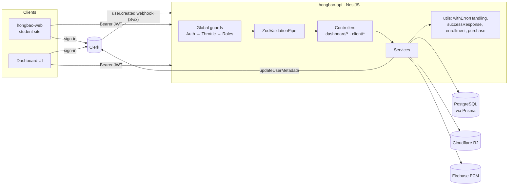
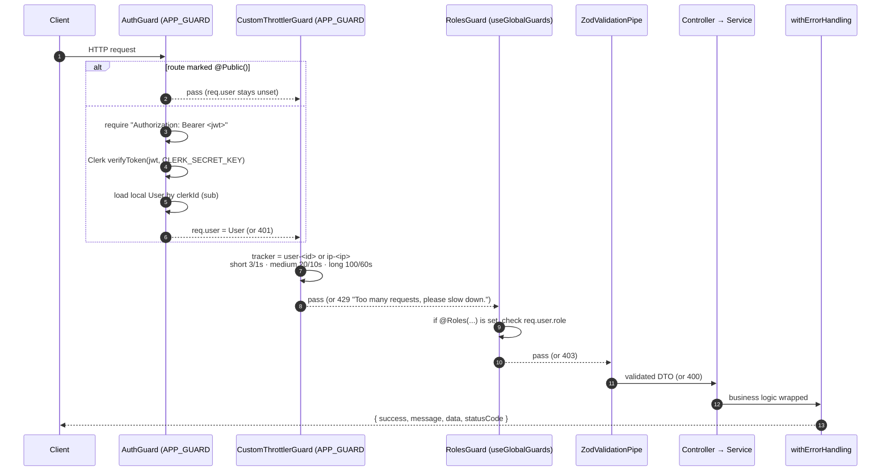
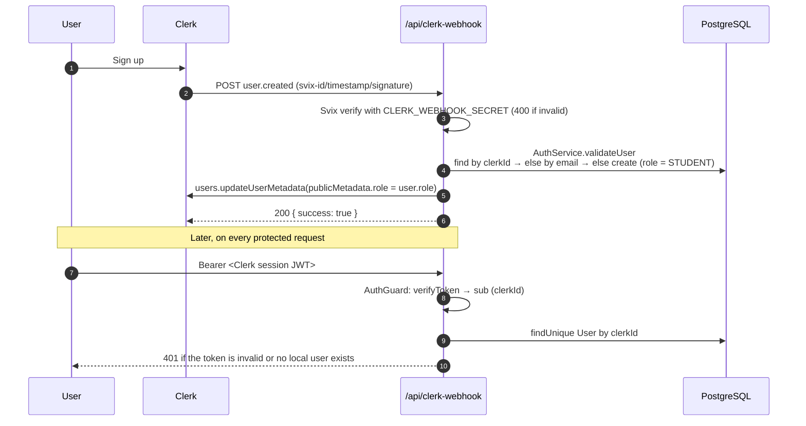
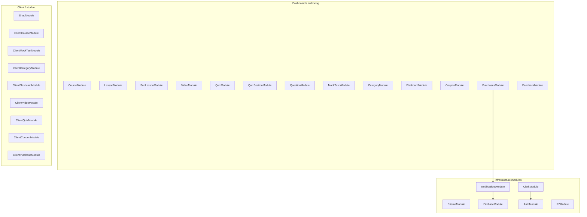
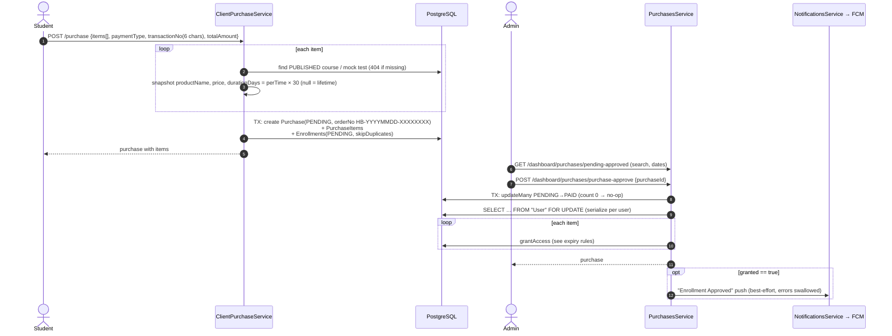
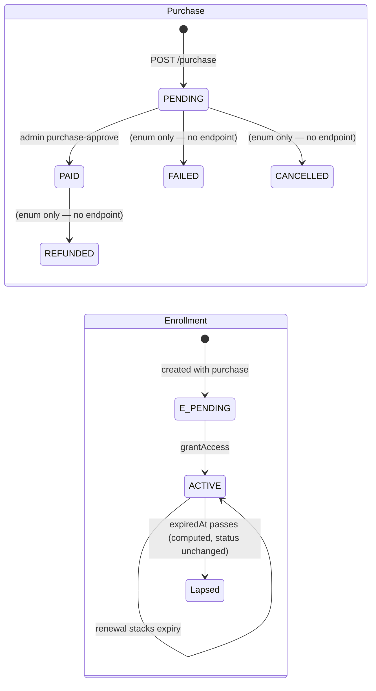
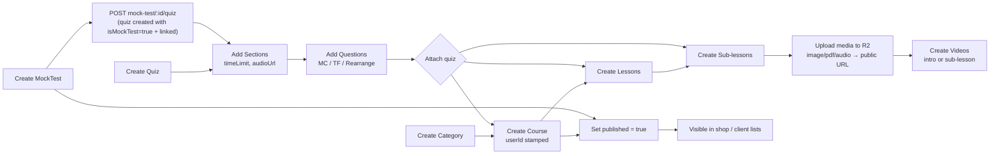

# Hongbao Chinese API — System, Flow & Logic Overview

> Scope: `apps/hongbao-api` (NestJS). Database structure is intentionally excluded — see `hongbao-chinese-erd.drawio` / `prisma/schema/` for that.
> Generated: 2026-11-13, from branch `development` (includes the in-progress *level-test → mock-test* rename).

---

## 1. System at a glance

Hongbao Chinese is a Chinese-learning platform. The API serves two audiences from one NestJS app:

| Audience | Route prefix | Purpose |
|---|---|---|
| **Dashboard** (admin / teacher / staff) | `/dashboard/*` | Author content (courses, lessons, quizzes, mock tests, flashcards, coupons), upload media, approve payments, send push notifications |
| **Client** (students / public visitors) | `/` (no prefix: `/shop`, `/purchase`, `/video`, `/quiz`, `/coupon`, `/all-*`, …) | Browse catalog, buy courses / mock tests, consume content, track progress |
| **Integrations** | `/api/clerk-webhook` | Clerk user-lifecycle webhook |

### Tech stack

| Concern | Choice |
|---|---|
| Framework | NestJS 11 on Express 5 |
| ORM / DB | Prisma 7 with `@prisma/adapter-pg` → PostgreSQL |
| Auth | Clerk (`@clerk/backend` `verifyToken`), Svix-signed webhooks |
| Validation & serialization | Zod via `nestjs-zod` (global `ZodValidationPipe` + `ZodSerializerInterceptor`); schemas live in the shared workspace package `@repo/shared` |
| Rate limiting | `@nestjs/throttler`, custom per-user tracker |
| File storage | Cloudflare R2 through the AWS S3 SDK |
| Push notifications | Firebase Admin (FCM) |
| API docs | Swagger at `/api/docs` (bearer auth `access-token`) |
| Deployment | VPS + PM2 + Nginx (see `VPS_Deployment_Guide.md`) |

### High-level architecture



---

## 2. Bootstrap & request pipeline

`src/main.ts` and `src/app.module.ts` set up the following:

1. **CORS** allows `http(s)://localhost:3000` and `https://hongbao-chinese.vercel.app`, with credentials.
2. **Raw body** on `/api/clerk-webhook` (`express.raw`) so the Svix signature can be checked against the exact bytes.
3. **Swagger** at `/api/docs`.
4. **Global pipe:** `ZodValidationPipe` validates every `@Body()` / `@Query()` against its `createZodDto(...)` class.
5. **Global interceptor:** `ZodSerializerInterceptor`.
6. **Global guards**, which run in this order:



> APP_GUARD providers are registered while `NestFactory.create()` runs. `app.useGlobalGuards(RolesGuard)` is called later, so `RolesGuard` runs last and can see `req.user`.

### Response envelope

Every service returns `successResponse({ data, message?, statusCode? })`:

```json
{ "success": true, "message": "Success", "data": { ... }, "statusCode": 200 }
```

### Error mapping (`utils/withErrorHandling.ts`)

| Thrown inside service | HTTP result |
|---|---|
| Any `HttpException` | passed through unchanged |
| Prisma `P2025` (record not found) | `404 Record not found` |
| Prisma `P2002` (unique violation) | `409 A record with this <field> already exists` |
| Prisma `P2003` (FK violation) | `400 Invalid reference to related record` |
| Other Prisma known error | `400 <prisma message>` |
| `PrismaClientValidationError` | `400 Invalid data provided` |
| Any other `Error` | `500 <message>` |

### Shared contract (`@repo/shared`)

The request schemas (Zod) and enums are defined once in `packages/shared` and used by both the API and the frontends. `src/common/shared-enums.check.ts` makes type-checking fail if a shared enum drifts from its Prisma enum.

---

## 3. Authentication & authorization

### 3.1 Identity flow (Clerk → local user)



Key points:

* The **local `User` row is the source of truth for roles.** Clerk's `publicMetadata.role` is a copy so the frontend can read it.
* Only `user.created` is handled. Updates and deletions in Clerk are not synced.
* A user whose webhook hasn't arrived yet gets `401 User not found`.
* `GET /me` returns the local `User` (`req.user`).
* `ClerkStrategy` (Passport) and the `TokenChecker` middleware exist but **are not wired in**. `AuthGuard` does the work.

### 3.2 Roles

Roles are `ADMIN`, `TEACHER`, `STAFF` and `STUDENT`. Routes opt in with `@Roles(...)`. A route with no `@Roles` only requires a valid login.

| Guarded with `@Roles` | Roles |
|---|---|
| `dashboard/course` create / get-one / update / delete | ADMIN |
| `dashboard/notifications/send-to-user` | ADMIN |
| `dashboard/mock-test/*` | ADMIN, TEACHER |
| `dashboard/question/*` | ADMIN, TEACHER |
| `dashboard/upload-*`, `dashboard/delete-file` (R2) | ADMIN, TEACHER |

The other `dashboard/*` controllers have **no role check** (see §8): category, coupon, feedback, flashcard, lesson, sub-lesson, quiz, quiz-section, video, purchases, and `GET dashboard/course`.

### 3.3 Public routes (`@Public()`)

`GET /`, `POST /api/clerk-webhook`, `GET /all-categories`, `GET /all-courses`, `GET /course-detail/:id`, `GET /all-flashcards`, `GET /all-mock-tests`, `GET /mock-test-detail/:id`, `GET /shop/all-products`, `GET /shop/product-overview`.

---

## 4. Module map



### Content hierarchy (logical, not schema)

```
Category ─┬─ Course ─┬─ intro Video(s)           (isIntroVideo = true)
          │          ├─ Quiz(zes)                (CourseQuiz link)
          │          └─ Lesson ─┬─ Quiz(zes)     (LessonQuiz link)
          │                     └─ SubLesson ─┬─ Video(s)
          │                                   └─ Quiz(zes)  (SubLessonQuiz link)
          ├─ MockTest ── Quiz (isMockTest = true, one per mock test via MockTestQuiz)
          └─ Flashcard

Quiz ─┬─ QuizSection (title, timeLimit, audioUrl, order) ── Question
      └─ Question (type: MULTIPLE_CHOICES | TRUE_OR_FALSE | REARRANGE, data JSON, order)
```

---

## 5. Endpoint catalogue

### 5.1 Client / public

| Method & path | Auth | What it does |
|---|---|---|
| `GET /` | public | Health / hello |
| `GET /me` | user | Current local user |
| `GET /all-categories` | public | Categories with `courseCount` and `flashcardCount` |
| `GET /all-courses` | public | Published courses (summary + category) |
| `GET /course-detail/:id` | public | Full course tree: intro videos, lessons → sub-lessons → videos and quizzes (flattened), plus `videoCount` and `lessonCount` |
| `GET /all-mock-tests?categoryId=` | public | Published mock tests with `testCount` (question count) |
| `GET /mock-test-detail/:id` | public | Published mock test with its quiz and ordered questions |
| `GET /all-flashcards?categoryId=` | public | Flashcards (CN word, pinyin, EN/MM meaning, example) |
| `GET /shop/all-products?type=all\|course\|mock-test&categoryId=` | public | Courses and mock tests merged, tagged with `type`, newest first |
| `GET /shop/product-overview` | public | Counts of published courses and mock tests |
| `POST /purchase` | user | Checkout (see §6.1) |
| `GET /purchase/my-purchases?page&limit&status` | user | Own purchases, paginated |
| `GET /purchase/my-enrollments?page&limit&type&status` | user | Own enrollments with a computed `hasAccess` |
| `GET /purchase/:id` | user | Own purchase detail (scoped by `userId`) |
| `POST /coupon/apply` · `DELETE /coupon/apply` | user | Redeem / un-redeem a coupon for a course (see §6.3) |
| `GET /video/:id` | user | One video (url, duration) |
| `GET /video/completed` | user | IDs of videos the user completed |
| `POST /video/:id/complete` | user | Upserts `UserProgress(VIDEO, COMPLETED)` |
| `GET /quiz/:id` | user | Quiz with ordered questions |

### 5.2 Dashboard

| Resource | Base path | Operations |
|---|---|---|
| Course | `dashboard/course` | CRUD; `create` / `update` stamp the editing user's `userId` |
| Lesson | `dashboard/lesson` | CRUD; `GET ?courseId=` |
| Sub-lesson | `dashboard/sub-lesson` | CRUD; `GET ?lessonId=` |
| Video | `dashboard/video` | CRUD; filter by `courseId` / `lessonId` / `subLessonId` |
| Quiz | `dashboard/quiz` | CRUD (non-mock quizzes only in list); `find-all-quiz-for-attach` (unattached quizzes); attach / detach to course, lesson, sub-lesson or mock test |
| Quiz section | `dashboard/quiz-section` | create; get / update by `quiz/:quizId/section/:sectionId`; delete |
| Question | `dashboard/question` | CRUD; `GET ?quizzId=&sectionId=` matches questions directly on the quiz **or** in its sections |
| Mock test | `dashboard/mock-test` | CRUD + nested quiz CRUD under `:id/quiz[/:quizId]` (ownership checked via `MockTestQuiz`) |
| Category | `dashboard/category` | CRUD; connect / disconnect courses |
| Flashcard | `dashboard/flashcard` | CRUD; `GET ?categoryId=` |
| Coupon | `dashboard/coupon` | CRUD; `courseIds` replaces the restriction list; attach / detach a course |
| Purchases | `dashboard/purchases` | `list` (PAID / PENDING counts), `pending-approved`, `approved` (paginated + search + date range), `purchase-approve` |
| Feedback | `dashboard/feedback` | CRUD |
| Uploads (R2) | `dashboard/upload-image\|pdf\|audio`, `dashboard/delete-file?id=` | Multipart `file` → R2 key and public URL |
| Notifications | `dashboard/notifications` | `send-to-user` (ADMIN), `save-noti-token` (register FCM token for the caller) |

---

## 6. Core business flows

### 6.1 Purchase → approval → access (manual payment)

Payment happens off-platform (e.g. bank / wallet transfer). The student submits a transaction reference, and an admin confirms it.



**Enrollment expiry rules (`PurchasesService.grantAccess`):**

| Situation | New `expiredAt` |
|---|---|
| Item is lifetime (`durationDays = null`) | `null` (lifetime) |
| Existing enrollment is active **and** lifetime | stays `null` (a timed purchase never shortens lifetime access) |
| Existing enrollment is active with a future expiry | `existing.expiredAt + durationDays × quantity` (stacks) |
| No enrollment, or it has expired / is pending | `now + durationDays × quantity`; `startedAt` reset to now |

The status is set to `ACTIVE` and `orderNo` points to the latest purchase. Items whose product was deleted after checkout are skipped.

**Idempotency and concurrency**

* Only the `PENDING → PAID` transition grants access, so double clicks or retries do nothing.
* A row lock on the user stops two approvals for the same user from both extending from the same old expiry.
* If a confirmation targets a purchase that is neither PENDING nor PAID, it returns `400 Purchase is <status> and cannot be confirmed`.

**Access check (`utils/enrollment.ts`).** Access requires `status = ACTIVE` **and** (`expiredAt = null` **or** `expiredAt > now`). No job sets `EXPIRED`, so every reader must check the date, not just the status. Helpers: `isEnrollmentActive`, `activeEnrollmentWhere`, `hasProductAccess`, `enrollmentUniqueWhere`.

### 6.2 Purchase / enrollment state machine



### 6.3 Coupon redemption

`POST /coupon/apply {code, courseId}`. The code is trimmed and upper-cased by the schema.

1. The course must exist (else `400`).
2. In one transaction:
   * Load the coupon with its course restrictions and **this user's** redemption count.
   * Check, in order: exists → `isActive` → `startsAt ≤ now` → `expiresAt ≥ now` → course allowed (an empty list means every course) → `perUserLimit`.
   * Increment `usedCount` with a conditional `updateMany` (`usageLimit IS NULL OR usedCount < usageLimit`). This is atomic, so the global limit can't be oversold under concurrency.
   * Create a `CouponRedemption` with the discount value.
3. Return `{redemptionId, couponId, code, discountType, discountValue}`.

`DELETE /coupon/apply` removes the user's most recent redemption for that code and course and decrements `usedCount`.

> The redemption is **not linked to the purchase**. `POST /purchase` does not read the coupon, and the discount is applied by the client in `totalAmount` (see §8).

### 6.4 Content authoring



* **Quiz reuse:** `find-all-quiz-for-attach` lists non-mock quizzes that aren't attached to a course, lesson or sub-lesson yet.
* **Mock-test quizzes:** attaching sets `isMockTest = true` and detaching sets it back to `false`, so they stay out of the regular quiz list.
* **Uploads:** MIME allow-lists apply per type. Keys look like `images|pdfs|audios/YYYY/MM/<uuid>.<ext>` and the URL is `${R2_PUBLIC_URL}/${key}`.
* **Visibility:** client catalog endpoints only return `published: true` courses and mock tests. `course-detail/:id` does **not** filter on `published`.

### 6.5 Learning progress

`POST /video/:id/complete` upserts `UserProgress{entityType: VIDEO, entityId, status: COMPLETED, completedAt}`, which is unique per (user, type, entity). `GET /video/completed` returns the completed video IDs for the UI to show progress. The `ProgressEntityType` enum also covers COURSE / LESSON / SUB_LESSON / QUIZ / QUESTION / FLASHCARD, but only VIDEO has endpoints so far.

### 6.6 Push notifications

1. The client registers its FCM token with `POST dashboard/notifications/save-noti-token`. This upserts by token and re-assigns it to the current user.
2. `NotificationsService.sendToUser(payload, userId)` sends to all of that user's tokens with `Promise.allSettled` and returns `{sent, failed, total}`. It returns `404` if the user has no tokens.
3. It is called automatically after a purchase is approved, and manually through `send-to-user` (ADMIN).

---

## 7. Configuration (environment variables)

| Variable | Used by |
|---|---|
| `PORT` | HTTP port (default 3000) |
| `DATABASE_URL` | Prisma pg adapter |
| `CLERK_SECRET_KEY`, `CLERK_PUBLISHABLE_KEY` | Token verification, Clerk client |
| `CLERK_WEBHOOK_SECRET` | Svix webhook verification |
| `R2_BUCKET_NAME`, `R2_PUBLIC_URL`, `R2_S3_API_ENDPOINT`, `R2_ACCESS_KEY`, `R2_SECRET_ACCESS_KEY` | R2 storage (startup fails if any are missing) |
| `FIREBASE_PROJECT_ID`, `FIREBASE_CLIENT_EMAIL`, `FIREBASE_PRIVATE_KEY` | FCM (`\n` escapes are unescaped) |

---

## 8. Observations & risks

These come from reading the code and are listed for follow-up. They don't change the behaviour described above.

**Authorization gaps**

1. **Most dashboard routes have no `@Roles`.** Any signed-in STUDENT can call `dashboard/category`, `coupon`, `lesson`, `sub-lesson`, `quiz`, `quiz-section`, `video`, `flashcard`, `feedback` and **`purchases/purchase-approve`**. That means a student could approve their own purchase, or create coupons. The `@Roles` lines on lesson, sub-lesson and quiz are commented out.
2. **Paid content isn't gated by enrollment.** `hasProductAccess` / `activeEnrollmentWhere` are never called:
   * The public `GET /course-detail/:id` returns every sub-lesson video `url`, and doesn't filter on `published`.
   * The public `GET /mock-test-detail/:id` returns full question `data` and `explanation`, which likely includes the answers.
   * `GET /video/:id` and `GET /quiz/:id` only need a login, not an enrollment.

**Purchase integrity**

3. **`totalAmount` comes from the client.** It isn't compared with the sum of snapshotted item prices minus any coupon. Admins have to check the amount by hand against the transfer.
4. The `contact`, `months` and `promoCode` fields in `CreateClientPurchaseSchema` are validated but ignored. Duration always comes from the product's `perTime`, and `quantity` is never set.
5. Coupon redemptions are separate from purchases. A user can apply a coupon, never buy, and still use up the coupon's limit. Removing it frees the slot again.
6. `addPendingEnrollments` writes `orderNo` only for **new** enrollment rows (`skipDuplicates`).

**Other**

7. **`send-to-user` sends to the caller.** It uses `user.id` from `@CurrentUser()`, so an admin notifies themselves. The DTO doesn't take a target user.
8. **Clerk sync is one-way and only on create.** Changes to email, name or image, and deleted users, are not reflected. The role copied into Clerk metadata goes stale if the role changes in the DB.
9. **Unused code:** `ClerkStrategy`, the `TokenChecker` middleware, and `R2Service.getFile/listFiles`.
10. **Error handling is uneven.** Several admin `findOne` methods return `data: null` with 200 instead of 404 (course, quiz, question, video, quiz-section). `NotificationsService.saveNotiToken` isn't wrapped in `withErrorHandling` or the response envelope.
11. **Throttle limits are tight** (3 req/s per user). A dashboard or page that fires several parallel requests on load may hit `429`.
12. **The CORS list is hard-coded** in `main.ts` and has no dashboard origin other than localhost / vercel.
